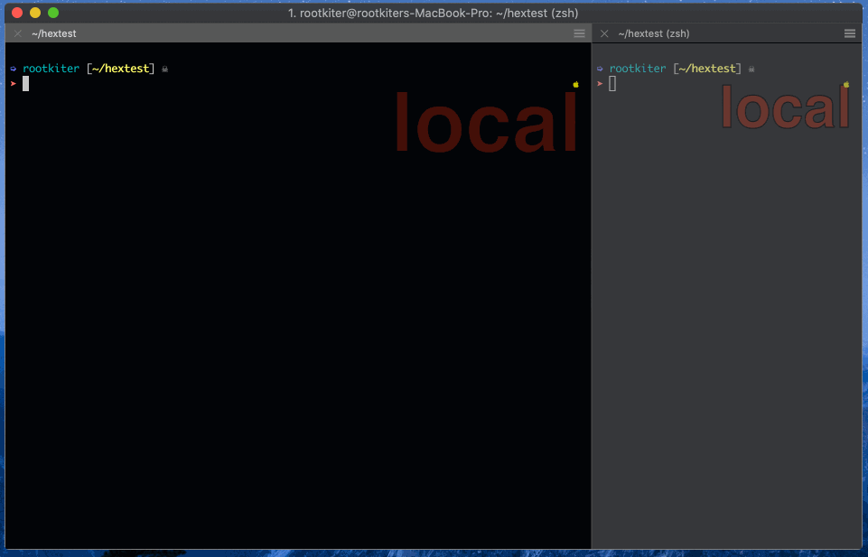

# vim-hexedit

[**中文文档**](README.zh-CN.md)

Edit binary files as hex inside Vim or Neovim, backed by `xxd`. Supports four
modes and can handle large files without loading them in full — see
`REQUIREMENTS.md` for the full design and `:help hexedit` once installed for
day-to-day usage.



> Note: this README describes the v2.0 command set. If you're upgrading from
> an older install, the commands below replace `:Hexedit`/`:Hexkeep`/
> `:Hex2C`/`:Hex2Py`, which no longer exist.

## Modes and commands

| Command | Mode | Editable | Notes |
|---|---|---|---|
| `:Hedit` | Hex 编辑模式 (Hex Edit) | Yes | offset / hex / ascii columns, in-place overwrite editing |
| `:Hex` | Hex 字串模式 (Hex string) | Yes | plain grouped hex text, allows insert/delete |
| `:H2C` | C 语言视图模式 (C view) | No | `unsigned char buf[] = { 0x41, ... };` |
| `:H2Py` | Python 视图模式 (Python view) | No | Python-3 `bytes.fromhex(...)` |

`:Hedit` / `:Hex` / `:H2C` / `:H2Py` switch directly between each other from
whichever mode you're currently in — you don't need to bounce back through
Hex Edit mode first.

Two more commands cross the boundary between plain Vim text and this plugin:

- `:HexLoad` — treat the current buffer's text as a hex string and enter Hex
  Edit mode. If the buffer already has a filename, you're asked once
  whether saving should keep the file in its original (binary) form
  (decode and overwrite with raw bytes) or convert it to a hex string
  (keep writing the hex-string form) — there's no silent default, since
  the file started out as text.
- `:HexDump` — from any active mode (not just Hex Edit), convert to
  hex-string text and leave the plugin entirely, back to normal Vim
  editing. Use `:HexLoad` again to re-enter.

Plus search support inside Hex Edit mode:

- `:Hsearch 41414141` searches for a hex byte sequence; `n` repeats it.
- `:HsearchClean` clears the search and restores `n`'s normal behavior.

## Tips

**Tip 1**: `f|` jumps straight to the `|` separator column, and the plugin's
cursor-snapping then lands you at the start of the ascii column — the
fastest way to hop from hex to ascii on the current line.

**Tip 2**: `:Hsearch 41414141` temporarily takes over the `n` key to mean
"repeat this hex search" instead of Vim's normal "repeat last search". Run
`:HsearchClean` when you're done to give `n` back its usual meaning.

**Tip 3**: on a large file (see below), `:HGoto 0x1000` jumps straight to a
byte offset instead of scrolling — it works with either decimal or
`0x`-prefixed hex.

**Tip 4**: if you edit in `:Hex` (Hex string) mode and the byte count
changes, saving on a large windowed file will ask you to confirm before
falling back to a full-file rewrite — expect that prompt, it's not an error.

## Auto-trigger

Hex Edit mode starts automatically when you:

- open a file in Vim's binary mode (`vim -b file`, `:e ++bin file`), or
- open a file matching `g:hexedit_patterns` (default
  `*.bin,*.dat,*.hex,*.o`).

## Large files

Files over `g:hexedit_large_file_threshold` (default 1MB) are opened
windowed: only a slice of the file is read via `xxd -s/-l`, and scrolling
near the edge of what's loaded reloads a new window centered on your
position. Every reload aligns the window to a multiple of
`g:octets_per_line` bytes, so a given file byte always shows up in the same
column regardless of which window loaded it — just like a normal hex dump.
Use `:HGoto {offset}` (decimal or `0x`-prefixed hex) to jump anywhere in
the file directly, or plain `G`/`gg` to jump to the true end/start of the
file (these are overridden from Vim's default buffer-relative behavior,
which would otherwise only reach the edges of the loaded window).
Saving a same-length edit patches just that byte range in place; changing
the byte count requires a confirmed full-file rewrite. See
`:help hexedit-large-files` for details.

## Configuration

All of these are set with `let g:... = ...` in your vimrc before the plugin
loads:

| Variable | Default | Meaning |
|---|---|---|
| `g:group_octets_num` | `2` | bytes per hex "cell" |
| `g:octets_per_line` | `16` | bytes per line |
| `g:hexedit_low_up` | `'lower'` | hex digit case (`'lower'`/`'upper'`) |
| `g:hexedit_patterns` | `'*.bin,*.dat,*.hex,*.o'` | auto binary-mode file patterns |
| `g:hexedit_xxd_options` | `''` | extra flags appended to the rendering `xxd` call |
| `g:hexedit_large_file_threshold` | `1048576` | bytes; above this, windowed editing kicks in |
| `g:hexedit_window_size` | `65536` | base window-size unit (bytes) |
| `g:hexedit_cache_window_ratio` | `3` | cache window = this × `g:hexedit_window_size` |
| `g:hexedit_c_varname` | `'buf'` | variable name used by C view mode |

Full reference: `:help hexedit`.

## Install

Requires `xxd`, `dd`, `sh`, `head`, `tail` on `$PATH` (standard on Unix-like
systems).

### Install under blank environment

```
    $ git clone https://github.com/rootkiter/vim-hexedit.git ~/.vim
```

### Install under Pathogen

```
    $ git clone https://github.com/rootkiter/vim-hexedit.git ~/.vim/bundle/vim-hexedit
```

## Development

Design rationale and architecture live in `REQUIREMENTS.md`. Tests are
dependency-free Vimscript, runnable headlessly:

```
    $ nvim --headless -u NONE -c "source tests/run.vim"
```

(or `vim` in place of `nvim` on a Vim 8.1+ install).
