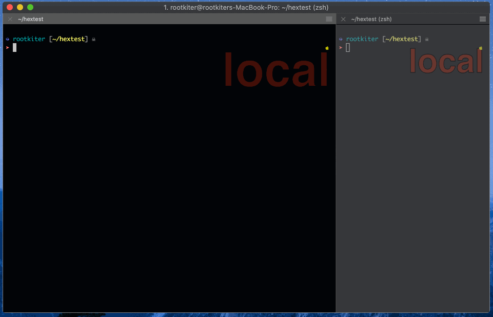

# vim-hexedit

[**English**](README.md)

在 Vim 或 Neovim 里以十六进制方式编辑二进制文件，底层依赖 `xxd`。支持四种模式，
并且能在不整文件加载的情况下处理大文件——完整设计见 `REQUIREMENTS.md`，装好插
件后日常用法见 `:help hexedit`。



> 提示：本 README 描述的是 v2.0 命令集。如果你是从旧版本升级，下面的命令替换了
> 已经不存在的 `:Hexedit`/`:Hexkeep`/`:Hex2C`/`:Hex2Py`。

## 模式与命令

| 命令 | 模式 | 可编辑 | 说明 |
|---|---|---|---|
| `:Hedit` | Hex 编辑模式 (Hex Edit) | 是 | 偏移 / hex / ascii 三列，原地覆盖编辑 |
| `:Hex` | Hex 字串模式 (Hex string) | 是 | 纯分组 hex 文本，允许插入/删除 |
| `:H2C` | C 语言视图模式 (C view) | 否 | `unsigned char buf[] = { 0x41, ... };` |
| `:H2Py` | Python 视图模式 (Python view) | 否 | Python 3 的 `bytes.fromhex(...)` |

`:Hedit` / `:Hex` / `:H2C` / `:H2Py` 可以从当前任意模式直接互相切换——不需要先
绕回 Hex 编辑模式。

另外两个命令负责在"普通 Vim 文本"和"本插件"之间跨界：

- `:HexLoad` —— 把当前 buffer 的文本当作 hex 字符串，进入 Hex 编辑模式。如果
  该 buffer 本来就有文件名，会先询问一次：保存时是保持文件原样（即二进制形
  式，解码后覆盖为原始字节），还是转化为 HexString 写入（继续以 hex 字符串
  形式写回）？这里不会有一个"不问就默认"的行为——原文件本来是文本，静默决
  定把它覆盖成二进制会很意外。
- `:HexDump` —— 不限于 Hex 编辑模式，在插件内任意激活的模式下都可以执行，把
  内容转换为 hex 字符串文本，并彻底离开插件，回到普通 Vim 编辑状态。想再进来
  就再执行一次 `:HexLoad`。

以及 Hex 编辑模式内的搜索能力：

- `:Hsearch 41414141` 搜索一段十六进制字节序列；`n` 重复搜索。
- `:HsearchClean` 清除搜索状态，把 `n` 的行为还给 Vim 原生的"重复上次搜索"。

## 使用技巧

**技巧 1**：`f|` 直接跳到 `|` 分隔符列，配合插件自带的光标吸附逻辑，会落在
ascii 列开头——是在当前行 hex/ascii 之间快速切换的最快方式。

**技巧 2**：`:Hsearch 41414141` 执行后会临时接管 `n` 键，让它表示"重复这次 hex
搜索"，而不是 Vim 原生的"重复上次搜索"。用完执行 `:HsearchClean` 把 `n` 的含义
还回去。

**技巧 3**：面对大文件（见下文）时，`:HGoto 0x1000` 可以直接跳到某个字节偏移，
不用一路滚动过去——十进制、`0x` 前缀十六进制都支持。

**技巧 4**：如果你在 `:Hex`（Hex 字串模式）里编辑导致字节数发生了变化，在窗口
化的大文件上保存时会先弹出确认提示，再降级为整文件重写——出现这个提示是预期行
为，不是报错。

## 自动触发

以下情况会自动进入 Hex 编辑模式：

- 以 Vim 的二进制模式打开文件（`vim -b file`、`:e ++bin file`）；
- 打开的文件名匹配 `g:hexedit_patterns`（默认 `*.bin,*.dat,*.hex,*.o`）。

## 大文件

超过 `g:hexedit_large_file_threshold`（默认 1MB）的文件会以"窗口化"方式打
开：只通过 `xxd -s/-l` 读取文件的一部分，滚动到已加载内容的边缘附近时，会以新
位置为中心重新加载一个窗口。每次重新加载都会把窗口起始位置对齐到
`g:octets_per_line` 字节的整数倍，因此同一个文件字节无论被哪个窗口加载到，都
会显示在同一列——和普通 hex dump 的寻址方式一致。可以用 `:HGoto {offset}`
（十进制或 `0x` 前缀十六进制）直接跳转到文件内任意位置，也可以直接用 `G`/`gg`
跳到文件真正的末尾/开头（这两个键在这里被改写过——Vim 原生的 `G`/`gg` 只会跳
到当前已加载窗口的边缘，而不是整个文件的边缘）。保存时，如果编辑没有改变字节
数，只会原地 patch 对应的字节区间；如果字节数变了，则需要确认后降级为整文件
重写。详见 `:help hexedit-large-files`。

## 配置项

以下变量都在 vimrc 里、插件加载之前用 `let g:... = ...` 设置：

| 变量 | 默认值 | 含义 |
|---|---|---|
| `g:group_octets_num` | `2` | 每个 hex "格子"包含的字节数 |
| `g:octets_per_line` | `16` | 每行显示的字节数 |
| `g:hexedit_low_up` | `'lower'` | hex 数字大小写（`'lower'`/`'upper'`） |
| `g:hexedit_patterns` | `'*.bin,*.dat,*.hex,*.o'` | 自动进入二进制模式的文件名匹配规则 |
| `g:hexedit_xxd_options` | `''` | 追加给渲染用 `xxd` 调用的额外参数 |
| `g:hexedit_large_file_threshold` | `1048576` | 字节数；超过此值触发窗口化编辑 |
| `g:hexedit_window_size` | `65536` | 窗口大小的基础单位（字节） |
| `g:hexedit_cache_window_ratio` | `3` | 缓存窗口 = 该值 × `g:hexedit_window_size` |
| `g:hexedit_c_varname` | `'buf'` | C 视图模式使用的变量名 |

完整参考文档：`:help hexedit`。

## 安装

需要 `$PATH` 里有 `xxd`、`dd`、`sh`、`head`、`tail`（类 Unix 系统标配）。

### 在空环境下安装

```
    $ git clone https://github.com/rootkiter/vim-hexedit.git ~/.vim
```

### 通过 Pathogen 安装

```
    $ git clone https://github.com/rootkiter/vim-hexedit.git ~/.vim/bundle/vim-hexedit
```

## 开发

设计思路与架构说明在 `REQUIREMENTS.md` 里。测试是不依赖第三方框架的纯
Vimscript，可以无头（headless）运行：

```
    $ nvim --headless -u NONE -c "source tests/run.vim"
```

（在装有 Vim 8.1+ 的环境下，把 `nvim` 换成 `vim` 也可以）。
